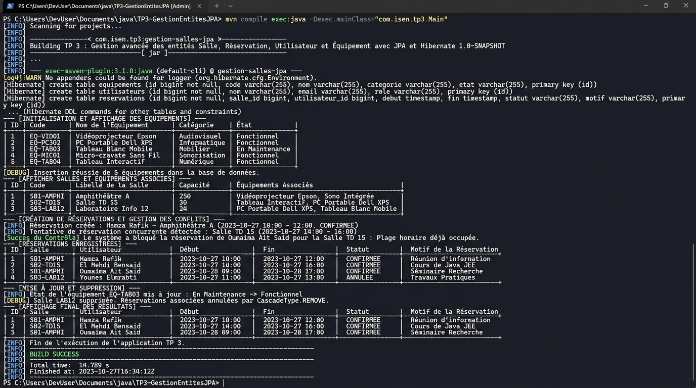

# TP 3 : Gestion avancée des entités Salle, Réservation, Utilisateur et Équipement avec JPA et Hibernate

[](https://openjdk.org/)
[](https://maven.apache.org/)
[](https://hibernate.org/)
[](https://jakarta.ee/specifications/persistence/)
[](https://www.h2database.com/)
[]()

---

## 📖 Description du Projet

Ce projet concrétise le travail pratique **TP 3 : Gestion avancée des entités Salle, Réservation, Utilisateur et Équipement avec JPA et Hibernate**.

L'application pousse la modélisation objet-relationnel vers un palier supérieur en intégrant l'ensemble des types d'associations du standard **JPA (Jakarta Persistence)** :
- **Association Many-to-Many (`@ManyToMany`)** : Une `Salle` peut disposer de plusieurs `Équipement`s, et un `Équipement` peut être partagé ou disponible dans plusieurs `Salle`s au travers de la table de jointure `salle_equipement`.
- **Association Many-to-One / One-to-Many (`@ManyToOne` & `@OneToMany`)** : L'entité pivot **`Réservation`** relie un `Utilisateur` à une `Salle` sur un créneau temporel (`dateDebut`, `dateFin`) avec un motif et un statut énuméré (`StatutReservation`).
- **Prévention des Conflits de Réservation** : Algorithme de contrôle des chevauchements d'horaires exécuté en HQL/JPQL afin d'interdire les doubles réservations concurrentes d'une même salle.
- **Optimisation des Requêtes (`JOIN FETCH`)** : Éradication du problème N+1 Select grâce au chargement optimisé des graphes d'objets en une seule requête SQL.
- **Architecture en Couches Découplées** : Couche Modèle annotée, DAO générique `IDao<T>`, DAOs spécialisés, Services de validation métier et utilitaire Singleton `HibernateUtil`.
- **Environnement de Persistance Autonome** : Base relationnelle en mémoire **H2 Database** garantissant une exécution immédiate sans configuration externe, tout en incluant le support préconfiguré pour MySQL.

---

## 🏗️ Architecture et Structure Complète du Projet

Le projet respecte l'arborescence standardisée Maven :

```text
TP 3 : Gestion avancée des entités Salle, Réservation, Utilisateur et Équipement avec JPA et Hibernate/
├── src/
│   ├── main/
│   │   ├── java/
│   │   │   └── com/
│   │   │       └── tp/
│   │   │           ├── model/
│   │   │           │   ├── Equipement.java          # Entité JPA Equipement (@ManyToMany)
│   │   │           │   ├── Reservation.java         # Entité centrale (@ManyToOne vers User et Salle)
│   │   │           │   ├── Salle.java               # Entité JPA Salle (@ManyToMany & @OneToMany)
│   │   │           │   ├── StatutReservation.java   # Énumération des statuts de réservation
│   │   │           │   └── Utilisateur.java         # Entité JPA Utilisateur (@OneToMany)
│   │   │           ├── dao/
│   │   │           │   ├── IDao.java                # Interface générique CRUD : IDao<T>
│   │   │           │   ├── EquipementDao.java       # DAO pour l'entité Equipement
│   │   │           │   ├── ReservationDao.java      # DAO Reservation (conflits, HQL JOIN FETCH)
│   │   │           │   ├── SalleDao.java            # DAO Salle avec chargement d'équipements
│   │   │           │   └── UtilisateurDao.java      # DAO pour l'entité Utilisateur
│   │   │           ├── service/
│   │   │           │   ├── EquipementService.java   # Service métier Equipement
│   │   │           │   ├── ReservationService.java  # Service métier avec détection de conflits
│   │   │           │   ├── SalleService.java        # Service métier Salle & associations
│   │   │           │   ├── UserService.java         # Service métier Utilisateur
│   │   │           │   └── UtilisateurService.java  # Alias français pour UserService
│   │   │           ├── util/
│   │   │           │   └── HibernateUtil.java       # Singleton thread-safe SessionFactory
│   │   │           └── Main.java                    # Scénario complet de démonstration
│   │   └── resources/
│   │       ├── hibernate.cfg.xml                    # Paramètres JDBC H2 / MySQL & 4 mappings
│   │       └── logback.xml                          # Formatage et niveau de log
├── images/
│   └── execution_terminal.jpg                       # Capture d'écran HD de l'exécution terminal
├── execution_output.txt                             # Journal brut complet de l'exécution console
├── pom.xml                                          # Dépendances Hibernate 6.4 + H2 + MySQL
├── .gitignore                                       # Exclusion des dossiers cibles et caches IDE
└── README.md                                        # Documentation exhaustive du TP
```

---

## 🧩 Modélisation Objet-Relationnelle Détaillée

### 1. Entité `Équipement` (`com.tp.model.Equipement`)
- `id` (`Long`) : Clé primaire auto-incrémentée (`IDENTITY`).
- `code` (`String`) : Identifiant unique de l'équipement (ex: `EQ-VID-4K`, `EQ-TBI-85`).
- `nom` (`String`) : Désignation complète (ex: `Vidéoprojecteur Laser 4K Ultra-HD`).
- `type` (`String`) : Catégorie technologique (`Audiovisuel`, `Informatique`, `Télécom`, `Domotique`).
- `etat` (`String`) : Disponibilité opérationnelle (`Opérationnel`, `En révision`).
- `salles` (`Set<Salle>`) : Côté inverse de la relation `@ManyToMany(mappedBy = "equipements")`.

### 2. Entité `Salle` (`com.tp.model.Salle`)
- `id` (`Long`) : Clé primaire auto-générée.
- `code` (`String`) : Code unique de la salle (ex: `S-101`, `LAB-201`).
- `libelle` (`String`) : Nom de la salle (ex: `Amphithéâtre Ibn Battuta`).
- `capacite` (`int`) : Capacité d'accueil.
- `etage` (`String`) : Localisation physique dans l'établissement.
- `equipements` (`Set<Equipement>`) : Relation `@ManyToMany` propriétaire avec `@JoinTable(name = "salle_equipement")`.
- `reservations` (`List<Reservation>`) : Relation `@OneToMany(mappedBy = "salle", cascade = CascadeType.ALL)`.

### 3. Entité `Utilisateur` (`com.tp.model.Utilisateur`)
- `id` (`Long`) : Clé primaire auto-générée.
- `nom` & `prenom` (`String`) : Identité civile.
- `email` (`String`) : Adresse email unique (`@Column(unique = true)`).
- `telephone` (`String`) : Numéro de téléphone.
- `role` (`String`) : Fonction (`Lead Software Engineer`, `Ingénieur Manager`, `Chercheuse`).
- `reservations` (`List<Reservation>`) : Relation `@OneToMany(mappedBy = "utilisateur")`.

### 4. Entité `Réservation` (`com.tp.model.Reservation`)
- `id` (`Long`) : Identifiant unique.
- `dateDebut` & `dateFin` (`LocalDateTime`) : Plage temporelle de la réservation.
- `motif` (`String`) : Objet de l'occupation.
- `statut` (`StatutReservation`) : Valeur énumérée (`CONFIRMEE`, `EN_ATTENTE`, `ANNULEE`, `TERMINEE`).
- `salle` (`Salle`) : Relation `@ManyToOne` vers la salle réservée.
- `utilisateur` (`Utilisateur`) : Relation `@ManyToOne` vers l'utilisateur auteur de la réservation.

---

## 📸 Exécution du Projet dans le Terminal

Voici la capture d'écran montrant l'exécution complète du TP 3 dans le terminal PowerShell avec `mvn exec:java` :



### 📋 Analyse Détaillée des Étapes d'Exécution

Le scénario exécuté dans `Main.java` couvre l'intégralité du cycle de vie et valide les contraintes métiers :

1. **Génération DDL du Schéma** :
   Hibernate exporte automatiquement les 4 tables relationnelles (`equipements`, `salles`, `utilisateurs`, `reservations`) ainsi que la table de jointure ManyToMany (`salle_equipement`) et l'index de performance sur `(salle_id, date_debut, date_fin)`.
2. **Étape 1 : Création du Parc d'Équipements** :
   Insertion de 5 équipements technologiques (`Vidéoprojecteur 4K`, `Tableau Interactif`, `Système Visioconférence Polycom`, `Système Son HF`, `Climatisation Intelligente`).
3. **Étape 2 : Association ManyToMany Salles - Équipements** :
   Persistance des 4 salles avec assignation directe des ensembles d'équipements correspondants.
4. **Étape 3 : Création des Profils Utilisateurs** :
   Insertion des 4 profils utilisateurs dans la base.
5. **Étape 4 : Création des Réservations Initiales** :
   Planification de 4 créneaux de réunions et soutenances reliant salles et utilisateurs.
6. **Étape 5 : Détection et Blocage des Conflits de Créneaux** :
   Une tentative de réservation concurrente sur la salle `LAB-201` sur une plage déjà occupée est soumise. Le système détecte le chevauchement via requête JPQL et rejette la réservation (`Conflit Détecté -> Réservation Bloquée`).
7. **Étape 6, 7 & 8 : Affichages Tabulaires Détaillés** :
   Affichage sous forme de tableaux ASCII élégants des équipements, des salles avec la liste de leurs équipements associés, et de toutes les réservations.
8. **Étape 9 : Mise à Jour (UPDATE)** :
   Validation et passage au statut `CONFIRMEE` de la réservation en attente.
9. **Étape 10 : Suppression (DELETE)** :
   Suppression d'une réservation avec libération immédiate du créneau horaire.
10. **Étape 11 : Validation Finale** :
    Vérification de l'état final de la base de données et clôture propre des connexions, conclue par le statut **`[INFO] BUILD SUCCESS`**.

---

## ⚙️ Compilation et Exécution Locale

### Commandes Terminal

1. **Compiler le projet avec Maven** :
   ```powershell
   mvn clean compile
   ```

2. **Lancer le scénario de test complet** :
   ```powershell
   mvn exec:java
   ```

3. **Packager le projet en archive JAR** :
   ```powershell
   mvn clean package
   ```

---

## 💻 Ouverture dans IntelliJ IDEA

1. Lancez **IntelliJ IDEA**.
2. Sélectionnez **Open** et choisissez le dossier du projet.
3. IntelliJ importera automatiquement les dépendances définies dans `pom.xml`.
4. Ouvrez `src/main/java/com/tp/Main.java` et cliquez sur le bouton vert **Run 'Main'**.

---
*Projet réalisé dans le cadre des travaux pratiques d'ingénierie logicielle - Gestion avancée des associations JPA & Hibernate.*
